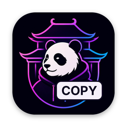

  

<h1 align="center">Show My Copy</h1>

История буфера обмена для macOS по одному сочетанию клавиш.

  
  
  
  

<a href="README.md">English version</a>

## Текущее состояние (0.1)

Show My Copy на ранней стадии разработки. Релизов пока нет — соберите приложение из исходников. Что уже работает:

- **История текста в фоне.** Скопированный текст собирается незаметно, вместе с названием приложения, из которого его скопировали.
- **История переживает перезапуск.** Она хранится только на вашем Mac, в песочнице приложения, и не попадает в резервные копии. Сохранённые пароли шифруются ключом из вашей связки ключей.
- **Окно по сочетанию клавиш.** По умолчанию ⌥⌘V, меняется в настройках. Открывает последние записи поверх любого приложения.
- **Поиск и управление с клавиатуры.** Начните печатать, чтобы отфильтровать записи; стрелки — выбор, Enter — снова скопировать запись в буфер, Esc — закрыть.
- **Лимит записей** от 10 до 1000, по умолчанию 50. Если при уменьшении лимита удалятся старые записи, приложение сначала спросит.
- **Очистка истории** в настройках, с подтверждением. История удаляется и с диска.
- **Расход на виду.** В настройках видно, сколько занимает история — отдельно текст и пароли, — и сколько памяти использует приложение. Можно ограничить размер истории: 100 МБ, 500 МБ или 1 ГБ; если при этом удалятся старые записи, приложение сначала спросит.
- **Пауза, пока Mac спит или экран заблокирован.**
- **Пароли не сохраняются** по умолчанию: пропускаются записи, которые менеджер паролей пометил как скрытые, и всё, что скопировано из известного менеджера паролей. Записи с пометкой «временная» или «создана автоматически» тоже пропускаются. Если менеджер паролей очищает буфер после пароля, скопированного без пометки, запись удаляется и из истории.
- **Сохранение паролей — по желанию.** Включите его в настройках, и пароли будут храниться в истории скрытыми: кнопка с глазом показывает пароль, поиск их не находит, а через 1 минуту, 10 минут или 1 час они удаляются.
- **Без значка в строке меню и в Dock.**
- **Русский и английский** интерфейс.
- **Приватность.** Без аналитики и сети, в песочнице.

Удалённые записи могут оставаться в свободном месте файла истории, пока их не перезапишут. Пароль, скопированный без пометки из приложения, которое не известно как менеджер паролей (например, из расширения браузера), может сохраниться как обычный текст — подробности и известные ограничения в [SECURITY.md](SECURITY.md).

## Что будет уметь

Пока не готово:

- **Не только текст.** Форматированный текст, картинки и файлы.
- **Кнопка в Пункте управления** на macOS 26.
- **Сколько места история занимает на диске** — в настройках.

## Сборка

Нужны Xcode 26 и macOS 15+.

Откройте `ShowMyCopy.xcodeproj` и запустите схему `ShowMyCopy`.

| Команда | Что делает |
|---|---|
| `make test` | юнит-тесты (Swift Testing) |
| `make lint` | SwiftLint + swift-format, строгий режим; проверки безопасности и переводов |
| `make format` | автоформатирование |
| `make security` | собрать Release с ad-hoc подписью и проверить его права (entitlements) |

Для `make lint` нужен SwiftLint: `brew install swiftlint`.

## Лицензия

[MIT](LICENSE)
